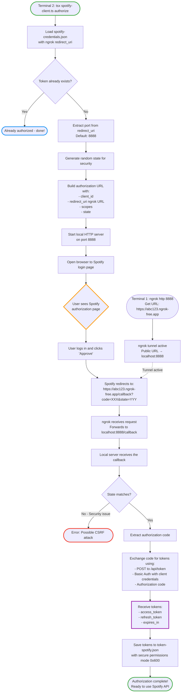
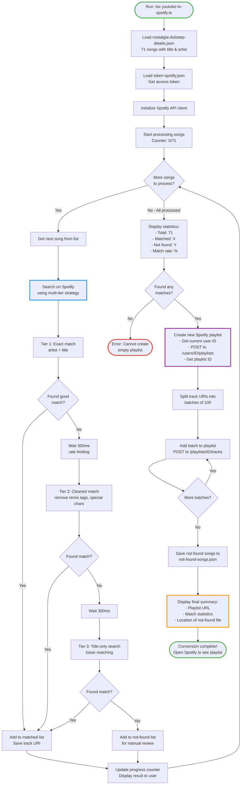
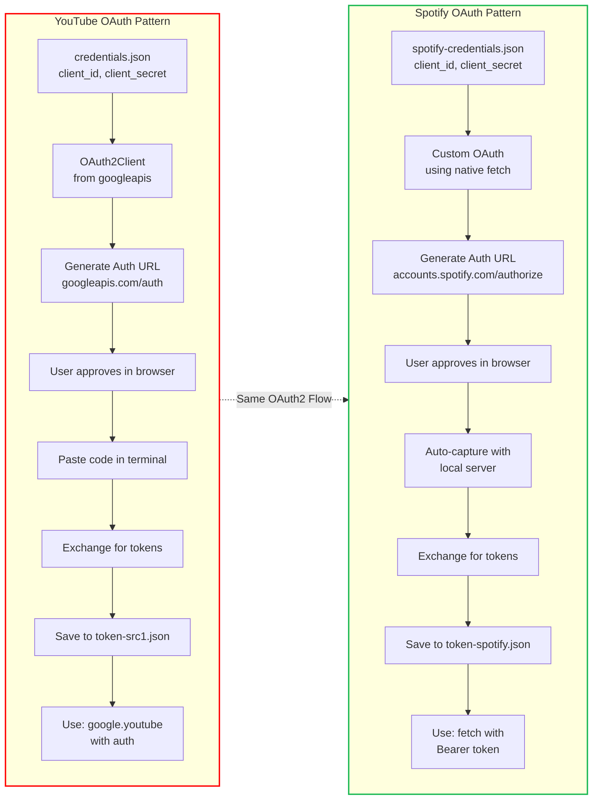

# Spotify OAuth2 & Playlist Creation - Learning Guide

This document explains how the Spotify integration works, with visual flowcharts to help you understand OAuth2 authentication and the playlist conversion process.

## Table of Contents
1. [OAuth2 Authorization Flow](#oauth2-authorization-flow)
2. [Playlist Conversion Process](#playlist-conversion-process)
3. [Multi-Tier Search Strategy](#multi-tier-search-strategy)
4. [Comparing YouTube vs Spotify OAuth](#comparing-youtube-vs-spotify-oauth)
5. [Key Concepts Explained](#key-concepts-explained)

---

## OAuth2 Authorization Flow (with ngrok)

This flowchart shows how your application gets permission to access your Spotify account using OAuth2. Since Spotify requires a public HTTPS redirect URI, we use ngrok to tunnel requests to your local server.



### What's Happening Here?

1. **ngrok Setup**: First, you start ngrok to create a public tunnel to your local port 8888
2. **Initial Setup**: Your app reads the Client ID, Secret, and ngrok redirect URI from `spotify-credentials.json`
3. **Port Extraction**: The app automatically extracts the port from your redirect_uri (defaults to 8888)
4. **Security State**: A random state is generated to prevent CSRF (Cross-Site Request Forgery) attacks
5. **Authorization URL**: The app builds a special URL that includes what permissions (scopes) it needs
6. **User Consent**: You see a Spotify page asking "Do you want to allow this app to access your Spotify account?"
7. **Callback via ngrok**: After approval, Spotify redirects to your ngrok URL, which tunnels to your local server
8. **Token Exchange**: Your app trades the temporary code for permanent tokens (access & refresh)
9. **Token Storage**: Tokens are saved securely for future use

**Why ngrok?** Spotify requires HTTPS redirect URIs for security. ngrok creates a secure HTTPS tunnel to your local development server, making it accessible from the internet temporarily.

---

## Playlist Conversion Process

This shows the complete flow from loading your YouTube playlist JSON to creating a Spotify playlist.



### Key Steps Explained

1. **Data Loading**: Read the YouTube playlist JSON that contains song titles and artists
2. **Authentication**: Load your saved Spotify access token
3. **Search Loop**: For each of 71 songs, try to find it on Spotify using progressively looser search criteria
4. **Rate Limiting**: 300ms delays between searches to avoid hitting Spotify's rate limits
5. **Batch Processing**: Spotify API allows adding up to 100 tracks at once, so we batch the requests
6. **Logging**: Songs that couldn't be found are saved for you to review manually

---

## Multi-Tier Search Strategy

This diagram shows how the search tries increasingly flexible matching strategies.

```mermaid
flowchart LR
    Song[YouTube Song:<br/>Walk on by Sound Remedy Remix<br/>by Noosa - Topic] --> T1[Tier 1: Exact Search]

    T1 --> Q1["Query: artist:'Noosa' track:'Walk on by Sound Remedy Remix'<br/>Limit: 5 results"]
    Q1 --> C1{Confidence > 70%?}
    C1 -->|Yes| Found1([Match Found!<br/>Return result])
    C1 -->|No| T2

    T2[Tier 2: Cleaned Search] --> Clean["Clean title:<br/>- Remove 'Topic'<br/>- Remove parentheses<br/>- Remove brackets<br/>Result: 'Walk on by Sound Remedy Remix'"]
    Clean --> Q2["Query: 'Noosa Walk on by Sound Remedy Remix'<br/>Limit: 10 results"]
    Q2 --> C2{Confidence > 60%?}
    C2 -->|Yes| Found2([Match Found!<br/>Return result])
    C2 -->|No| T3

    T3[Tier 3: Title-Only] --> Q3["Query: 'Walk on by Sound Remedy Remix'<br/>Limit: 20 results<br/>Check similarity manually"]
    Q3 --> C3{Confidence > 50%?}
    C3 -->|Yes| Found3([Match Found!<br/>Lower confidence])
    C3 -->|No| NotFound([Not Found<br/>Log for manual review])

    style Song stroke:#2196F3,stroke-width:3px
    style Found1 stroke:#4CAF50,stroke-width:3px
    style Found2 stroke:#8BC34A,stroke-width:3px
    style Found3 stroke:#CDDC39,stroke-width:3px
    style NotFound stroke:#FF9800,stroke-width:3px
```



### Why Multi-Tier?

- **Tier 1** (Exact): Most accurate but fails if artist/title names differ slightly between YouTube and Spotify
- **Tier 2** (Cleaned): Handles differences in formatting and remix notation
- **Tier 3** (Loose): Catches songs with significant naming differences, but may occasionally match wrong songs
- Each tier has a confidence threshold to ensure quality matches

---

## Comparing YouTube vs Spotify OAuth

Both use the same OAuth2 pattern, just with different providers.



### Key Similarities

1. **Credentials File**: Both store Client ID and Secret
2. **Authorization URL**: Both redirect user to provider's website
3. **User Consent**: Both ask user to approve permissions (scopes)
4. **Token Exchange**: Both trade authorization code for access/refresh tokens
5. **Token Storage**: Both save tokens to local JSON files
6. **API Usage**: Both include tokens with each API request

### Key Differences

| Aspect | YouTube | Spotify |
|--------|---------|---------|
| **Library** | Uses googleapis library | Uses native fetch (no library) |
| **Code Input** | User pastes code manually | Automatic capture via local server |
| **Token Format** | JSON with Google-specific fields | JSON with Spotify-specific fields |
| **API Client** | `google.youtube({ auth })` | `fetch()` with Bearer token header |

---

## Key Concepts Explained

### What is OAuth2?

OAuth2 is a standard protocol that lets applications access your data **without knowing your password**. Think of it like a hotel key card:
- The hotel (Spotify) gives you a key card (access token)
- The key card only works for your room (limited permissions/scopes)
- The key card expires after checkout (tokens expire)
- You can ask for a new card (refresh token)

### What is an Access Token?

An access token is like a temporary password that:
- Proves your app is authorized to access Spotify
- Included in every API request: `Authorization: Bearer <token>`
- Expires after 1 hour (for security)
- Can be refreshed using the refresh token

### What is a Bearer Token?

"Bearer" means "whoever carries this token has permission". When you send:
```
Authorization: Bearer BQC4H7...abc123
```

You're saying: "I'm carrying a valid token, so let me in!"

### What are Scopes?

Scopes define what permissions your app requests:
- `playlist-modify-public`: Create and modify public playlists
- `playlist-modify-private`: Create and modify private playlists
- `playlist-read-private`: Read your private playlists

Think of scopes like checkbox permissions: "This app can ☑️ modify playlists, ☐ cannot read listening history"

### What is a Redirect URI?

The redirect URI is where Spotify sends you back after authorization:
- Must be pre-registered in your Spotify app settings
- Must be HTTPS (Spotify requirement for security)
- In our case: `https://YOUR_NGROK_URL.ngrok-free.app/callback`
- ngrok tunnels this to your local server at `localhost:8888/callback`
- Our local server captures the authorization code from the callback

**Why can't we use localhost directly?** Spotify's security policies require HTTPS redirect URIs. While localhost is fine for development with some OAuth providers, Spotify enforces HTTPS to prevent token interception.

### What is CSRF and State Parameter?

CSRF (Cross-Site Request Forgery) is an attack where a malicious site tricks you into making unwanted requests.

The `state` parameter prevents this:
1. Your app generates a random string: `state=abc123`
2. Includes it in the authorization URL
3. Spotify includes it in the callback: `?code=XXX&state=abc123`
4. Your app checks: "Does the state match?" If not, reject it!

### What is Rate Limiting?

APIs limit how many requests you can make per second to prevent abuse:
- Spotify: ~180 requests per minute
- If exceeded, you get a 429 error
- Our solution: 300ms delays between searches (max ~200 requests/minute)

### What is the Levenshtein Distance?

A way to measure how different two strings are:
- Counts minimum edits (insert, delete, replace) to change one string to another
- "Walk" → "Talk" = distance of 1 (replace W with T)
- Used to find similar song titles even with typos or slight differences

---

## Common Issues & Solutions

### Issue: ngrok tunnel expired
**Error**: Connection refused or 404 on callback
**Solution**: ngrok free URLs expire after ~2 hours or when you close the terminal
- Restart ngrok: `ngrok http 8888`
- Get the new URL from the terminal output
- Update your Spotify app settings with the new redirect URI
- Update `spotify-credentials.json` with the new redirect_uri
- Re-run authorization

### Issue: "Redirect URI mismatch"
**Error**: Spotify shows "INVALID_CLIENT: Invalid redirect URI"
**Solution**:
- Make sure the redirect_uri in `spotify-credentials.json` EXACTLY matches what's registered in Spotify Dashboard
- Include `/callback` at the end
- Use HTTPS, not HTTP
- Check for trailing slashes

### Issue: Token Expired
**Error**: `401 Unauthorized`
**Solution**: Tokens expire after 1 hour. You'll need to implement refresh token logic or re-authorize.

### Issue: Rate Limited
**Error**: `429 Too Many Requests`
**Solution**: Increase delays between requests or implement exponential backoff.

### Issue: Song Not Found
**Reason**: Song may not exist on Spotify, or names differ significantly
**Solution**: Check `not-found-songs.json` and search manually in Spotify

### Issue: Wrong Song Matched
**Reason**: Tier 3 search is too loose
**Solution**: Only use Tier 1 and Tier 2 results, or increase confidence thresholds

### Issue: Local server port already in use
**Error**: `EADDRINUSE: address already in use`
**Solution**:
- Check if another instance is running: `lsof -i :8888`
- Kill the process or use a different port
- Update your ngrok tunnel: `ngrok http 8889`
- Update redirect_uri accordingly

---

## Next Steps for Learning

1. **Experiment**: Try modifying the search tiers in `youtube-to-spotify.ts`
2. **Add Features**: Implement token refresh logic in `spotify-client.ts`
3. **Improve Matching**: Adjust similarity thresholds for better accuracy
4. **Error Handling**: Add retry logic for network failures
5. **Progress Bar**: Use a library like `cli-progress` for better UX

---

## Useful Resources

- [Spotify Web API Documentation](https://developer.spotify.com/documentation/web-api)
- [OAuth 2.0 Simplified](https://www.oauth.com/)
- [Understanding Bearer Tokens](https://oauth.net/2/bearer-tokens/)
- [HTTP Status Codes](https://developer.mozilla.org/en-US/docs/Web/HTTP/Status)
